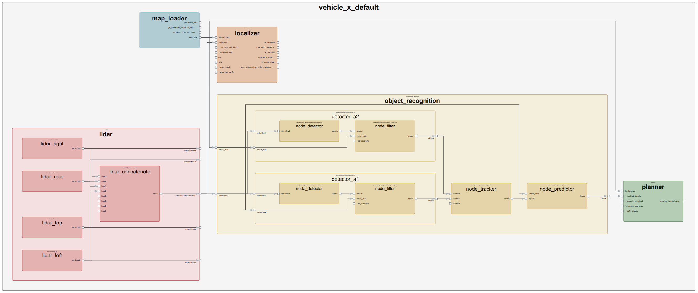
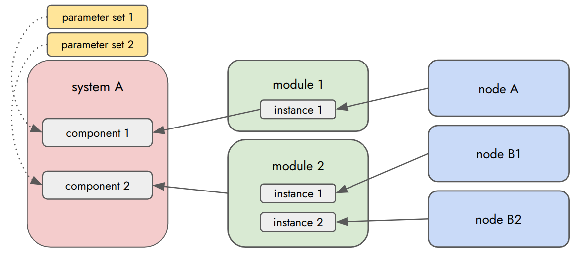

<picture>
  <source media="(prefers-color-scheme: dark)" srcset="autoware_system_designer_studio/autoware_system_designer_studio/web/img/awsd_icon_dark.svg">
  
</picture>

# Autoware System Designer

**Autoware System Designer** is a comprehensive toolset designed to define, build, and deploy Autoware systems in a modular and structured way. It allows developers to describe the software architecture using configuration files (YAML) and automatically generates system artifacts such as ROS 2 launch files and parameter templates, which the studio visualizes.

## Overview

Traditional ROS 2 launch files can become complex and hard to manage as a system grows. Autoware System Designer solves this by introducing a higher-level abstraction layer that separates **system design** from **deployment details**.



### Key Features

- **Modular Architecture**: Define systems using reusable **Nodes** and **Modules**.
- **Automatic Launch Generation**: Generate correct-by-construction ROS 2 XML launch files.
- **System Visualization**: The studio (`autoware_system_designer_studio`) draws diagrams from the exported artifacts, served live or packed for `file://`: the node graph, the logic diagram of trigger chains, and the sequence diagram, an event-chain latency view that reports the minimum, mean and maximum chain from the design's rates and a measurement file (see [doc/latency_view.md](autoware_system_designer/doc/latency_view.md)).
- **Parameter Management**: Manage parameters efficiently using **Parameter Sets** and schema validation.
- **Deployment Configuration**: Easily switch between different hardware configurations or simulation modes using **Deployments**.

## Core Concepts

The system is built upon four main entity types:



### 1. Node (`*.node.yaml`)

Represents a single ROS 2 node. It defines:

- **Package**: Package name and provider information.
- **Launch**: Node execution configuration (plugin, executable, container settings, etc.).
- **Inputs/Outputs**: Ports (topics) with message types, QoS settings, and remap targets.
- **Parameters**: Configuration variables (inline or via parameter files).
- **Processes**: Internal logic flow with trigger conditions and outcomes.

### 2. Module (`*.module.yaml`)

A container for grouping nodes and other sub-modules. It defines:

- **Instances**: Nodes/modules contained within.
- **Connections**: Wiring between internal components.
- **External Interfaces**: Ports exposed to the outside world.

### 3. System (`*.system.yaml`)

The top-level description of a complete autonomous driving system. It defines:

- **Variables**: System-wide configuration variables and variable files.
- **Components**: Top-level nodes/modules with compute unit assignment, namespaces, and parameter sets.
- **Node Groups**: Group nodes by listing their node paths (currently ROS 2 component containers are implemented).
- **Connections**: Data flow between components.
- **Modes**: Operation modes (e.g., Runtime, Simulation) with mode-specific overrides.

### 4. Parameter Set (`*.parameter_set.yaml`)

A collection of parameter overrides that can be applied to specific nodes in a system, allowing for flexible configuration management without modifying the core node definitions.

## Project Structure

To use Autoware System Designer in your ROS 2 package, organize your files as follows:

```text
src/<package_name>/
├── design/
│   ├── node/           # *.node.yaml
│   ├── module/         # *.module.yaml
│   ├── system/         # *.system.yaml
│   ├── parameter_set/  # *.parameter_set.yaml
│   └── border/         # <name>.border.yaml (components behind a generated launch file)
├── deployment/         # *.deployment.yaml (System instantiation)
├── schema/             # *.schema.json (Parameter schemas)
├── CMakeLists.txt
└── package.xml
```

## Build Integration

Autoware System Designer integrates directly into the CMake build process. Select the appropriate macros based on your package type.

In your `CMakeLists.txt`:

```cmake
find_package(autoware_system_designer REQUIRED)

# 1. Generate standalone node launchers (Optional)
# Use this if your package defines nodes and you want individual launch files.
autoware_system_designer_generate_launcher()

# 2. Generate parameter files from schemas (Optional)
# Use this if your package contains JSON schemas in the schema/ directory.
autoware_system_designer_parameter()

# 3. Build a full system deployment (Deployment Packages Only)
# Use this only in the package responsible for building the full system configuration.
autoware_system_designer_build_deploy(
  ${PROJECT_NAME}
  type_alpha.deployments
  PRINT_LEVEL=WARNING
  STRICT=AUTO  # AUTO|ON|OFF (AUTO follows AUTOWARE_SYSTEM_DESIGNER_BUILD_DEPLOY_STRICT)
)

# 4. Build a border (Optional)
# Generates share/<package>/launch/sensing.launch.xml from sensing.border.yaml under design/.
autoware_system_designer_build_deploy(
  ${PROJECT_NAME}
  sensing.border
  BORDER_OUTPUT=launch/sensing.launch.xml  # default: launch/<name>.launch.xml
)
```

### Border (`*.border.yaml`)

A border launches components behind a fixed launch-file interface, so a hand-written entry launch file can be replaced by a generated one at the same path. It is a local build input like a deployments table: plain YAML, no format declaration, no schema. It is not part of any system.

```yaml
name: sensing_perception # launch file stem; equals the file name stem

components: # as in a system, without compute units
  - name: sensing
    entity: SampleSensorKit.module
    path: /sensing
    parameter_set: [sample_system_sensing.parameter_set]
  - name: perception
    entity: Perception.module
    path: /perception
    parameter_set: [sample_system_perception.parameter_set]

arguments: # launch arguments of the generated file; $(var name) in parameter sets
  - name: data_path
    default: $(env HOME)/autoware_data/ml_models
variables: # build-time values, as in a system
  - name: sensor_model
    value: sample_sensor_kit

subscribers: # external interface: ports bound to topics
  - name: velocity_status
    topic: /vehicle/status/velocity_status
  - name: vector_map
    topic: /map/vector_map
publishers:
  - name: objects
    topic: /perception/object_recognition/objects

system_launches: # launch files included ahead of the components, e.g. the global parameter loader
  - package: autoware_global_parameter_loader
    file: launch/global_params.launch.py
    scoped: false # default true; false applies its parameters to the whole launch file
    arguments:
      - name: use_sim_time
        value: $(var use_sim_time)

node_groups: # as in a system; `external` loads into a container the caller starts
  - name: $(var pointcloud_container_name)
    type: ros2_component_container_mt
    external: true # holds nodes of both components
    nodes: [/sensing/lidar/*, /perception/obstacle_segmentation/*]

connections: # as in a system; the interface is reached as in a module
  - - subscriber.velocity_status
    - sensing.subscriber.velocity_status
  - - subscriber.vector_map
    - perception.subscriber.vector_map
  - - sensing.publisher.lidar/concatenated/pointcloud
    - perception.subscriber.concatenated_pointcloud
  - - perception.publisher.object_recognition/objects
    - publisher.objects
```

The border builds as a system on one compute unit. An interface connection binds the component port to the interface topic; a `*` at the end of both ends connects every interface port with a matching component port. Every interface port needs a connection. A container that holds nodes of more than one component is `external`.

The generated launch file follows the layout of a hand-written entry launch file:

1. arguments, with their defaults
2. external interfaces as arguments: `input/<subscriber>` and `output/<publisher>`, defaulting to their topics
3. internal interfaces as lets: `<component>/<port>` for each component publisher another component subscribes to
4. system launches
5. the nodes, in groups that push one namespace segment each; containers come first in their group

Node remaps reach interface topics through these variables, so overriding an interface argument rewires every node on that topic.

Node parameters resolved at build time are written to `config/<name>/<node path>.param.yaml` beside the launch file and loaded with `$(find-pkg-share <package>)`. Values carrying a substitution (`$(var ...)`) stay inline, and parameter files whose path is only known at launch time are loaded in place, keeping the launch order of default, override and mode parameters. Paths under a package directory are written as `$(find-pkg-share <package>)/...`, so the output does not depend on the workspace it was generated in.

A border can also be generated outside a package build:

```bash
# Writes launch/sensing.launch.xml and config/sensing/ into the package owning the border file.
python3 <autoware_system_designer>/script/generate_border.py <pkg>/design/sensing.border.yaml \
  [--output-root <dir>] [--source-only]
```

Packages resolve against the workspace install when it exists, otherwise against the sources (`--source-only` forces this). Parameter files generated during a package build exist only in the install.

## Use as an independent workspace

```sh
# make workspace and git clone
cd ~/workspace
git clone git@github.com:autowarefoundation/autoware_system_designer.git autoware_system_designer/src
cd autoware_system_designer

# set dependency
source /opt/ros/$ROS_DISTRO/setup.bash
rosdep update
rosdep install -y --from-paths src --ignore-src --rosdistro $ROS_DISTRO

# build
colcon build

# open the studio (use your web browser)
source install/setup.bash
autoware-system-designer-studio serve          # then open http://127.0.0.1:8780/
# or write a static copy that opens from file://: pack creates the -o directory
# (any path) and its index.html is the entry page
autoware-system-designer-studio pack -o ~/studio_view
xdg-open ~/studio_view/index.html
```

## Glossary

### Entity Definitions

- **System**: The complete software stack.
- **Module**: A reusable group of nodes/modules.
- **Node**: An atomic software unit (process).
- **Parameter Set**: Configuration overrides.

### Connectivity

- **Port**: An interface for data exchange (Input/Output).
- **Connection**: A link between ports.
- **Topic**: The resolved ROS 2 topic name.

### Execution

- **Process**: A logical unit of execution within a node (e.g., a callback).
- **Event**: A runtime occurrence of a process.

### Instantiation

- **Deployment**: A specific instance of a System tailored for an environment/vehicle.
- **Border**: Components launched behind a generated entry launch file with fixed topics and launch arguments.
- **Component**: A top-level instance within a System.
